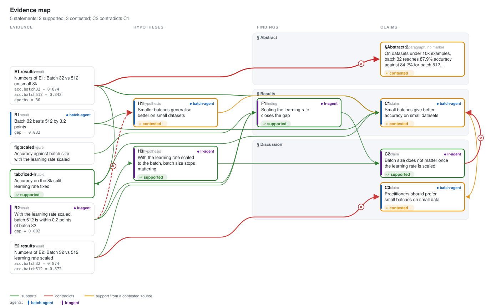
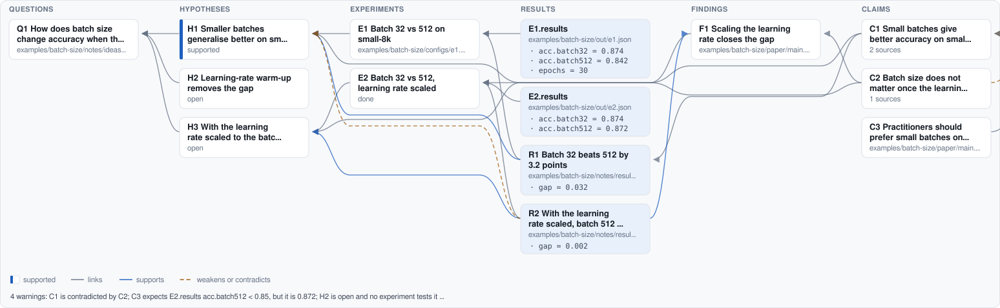

# research-diff

### `git diff` shows you lines. **research-diff shows you what your evidence says about your paper.**

When you run experiments and write a paper with Claude, and more so with a team of agents each on its own experiments
and sections, the paper's claims drift away from its evidence faster than anyone can re-read it. A new run quietly
weakens a hypothesis that three claims rely on; one agent's discussion contradicts another agent's results section; a
number in the paper no longer matches the results file.

**research-diff draws the paper's argument as a graph and keeps it current**: which findings and conclusions are
supported by which evidence, and above all **which evidence contradicts your own claims**, including where the paper
contradicts itself and where one agent's work contradicts another's. In plain colours: green supports, red contradicts.

<!-- research-map:begin -->




<details><summary>3 open warnings</summary>

- C1 is contradicted by C2
- C3 expects E2.results acc.batch512 < 0.85, but it is 0.872
- H2 is open and no experiment tests it

</details>
<!-- research-map:end -->

The graph above is this repository's own example (`examples/batch-size`), regenerated from its files on every change:
two agents, `batch-agent` and `lr-agent`; the Discussion's C2 contradicts the Results' C1, and C3 expects a number
(batch 512 below 85%) that the experiment E2 does not give.

## The evidence graph

Left to right: **evidence** (results, tracker runs, an experiment's numbers, optionally citations), **hypotheses**,
**findings**, **claims**, the paper's statements in a band per paper section. Every statement gets a verdict:

| | Verdict | Means |
|---|---|---|
| ✓ | supported | evidence for it, none against it |
| ◐ | contested | evidence for it and against it |
| ✗ | contradicted | evidence against it and none for it, or you marked it refuted |
| ○ | no evidence | nothing backs it, or only what has no evidence itself (an *ungrounded* support) |

A support only counts while its source holds. When a hypothesis is refuted, or a result is itself contradicted, the
support it gave becomes a **broken support** (dashed red), with why: *"C1 relies on H1, which R4 contradicts"*. So a
contradiction reaches every claim built on what it contradicts. A number a claim `expects:` supports it while it holds
and contradicts it when it does not.

```sh
research-diff evidence --out docs     # evidence.svg (README, appendix, slides), evidence.html (interactive),
                                      # evidence.mmd (Mermaid), evidence.md (a table), evidence.json
research-diff evidence --strict       # exit 1 while a statement is contradicted or contested (for CI)
research-diff show                    # the same, in any terminal; `research-diff show C3` for one claim's chain
research-diff suggest --links         # your LLM proposes supports/contradicts links nobody wrote, as a patch
```

The interactive page: click a claim and its evidence chain lights up; *Only contradictions* hides everything else; one
agent's work at a time.

## What it reads

Markers in your own files, in one grammar: an id (`Q` question, `H` hypothesis, `E` experiment, `R` result, `F`
finding, `C` claim, and a number) and a title, then links and a status on the lines after it.

```markdown
## H2: Learning-rate warm-up removes the gap      <- notes (Markdown): a heading or a list item
answers: Q1
status: open                                      <- open | supported | refuted | anything you like
by: lr-agent                                      <- who owns it (an agent of a team, or a person)
```

```latex
\section{Discussion}                              % the paper's sections become the graph's bands
% C2: Batch size does not matter once the learning rate is scaled
% relies on: F1, H3
% contradicts: C1                                 <- the paper contradicting itself, said out loud
% expects: E2.results acc.batch512 > 0.86        <- a number it needs; checked on every change
```

| Where | How |
|---|---|
| Notes (`.md`) | definitions as above; `tests:`, `of:`, `supports:`, `weakens:`, `contradicts:`, `relies on:`, `metrics: acc=0.91`, `by:` |
| The paper (LaTeX, or Markdown) | a comment: `% C1: Small batches win` with the same lines; the paragraph's `\cite{…}` become its sources; its `\section{}` its band |
| Experiment configs (YAML, JSON, TOML) | a `research:` block: `id`, `title`, `tests`, `status`, and `results: out/e1.json`, whose numbers become the result `E1.results` |
| Scripts and notebooks | a comment: `# research-diff: E2 tests H2` |
| Either end of a link | `supported by: R1`, `contradicted by: R4`, `weakened by: R2` are the same links written on the claim |

The graph is built from markers only, so the same files always give the same graph. It warns when a claim relies on
nothing or on a refuted hypothesis, when a number no longer meets what a claim `expects:`, when an open hypothesis has
no experiment, and when a link points at nothing.

## Install

1. The engine (Python 3.11+):
   ```sh
   pip install "research-diff[mcp]"        # or: pipx install "research-diff[mcp]"
   ```
2. The plugin, in Claude Code (the pane beside the chat, the hooks and the MCP server):
   ```
   /plugin marketplace add simplifiedmachine/research-diff
   /plugin install research-diff
   ```
   Or without the pane: `research-diff setup claude` (hooks, status line, a skill and the MCP server; `--undo`).
3. Restart Claude Code. The pane opens beside the chat; `/research-diff` opens it again.

## In Claude Code

- **The pane**: `n` Now · `r` Review · `e` Evidence · `a` Agents · `h` History. Arrows pick a claim (its evidence
  lights up), Enter zooms into its evidence chain, `b` goes back, `f` follows Claude. `/research-diff tui` opens the
  same in a terminal of its own, and `research-diff watch` in a browser at `http://127.0.0.1:8766/`.
  - **Now**: where Claude (or which agent) is working, every statement worst first, and what is **worth a look** since
    you last looked, ranked by consequence (the paper contradicting itself first) and each with why it matters.
  - **Review**: everything since your checkpoint, exactly, with a picture of only what changed.
  - **Evidence**: every statement by paper section with what supports it and what contradicts it.
  - **Agents**: the team, what each agent owns, its verdicts, where it contradicts another agent, and the bus.
  - **History**: how the research got here: *"You asked: run the LR ablation → it got: R2, H1 supported → contested,
    1 new contradiction (C2 contradicts C1)"*, for the whole study or one claim.
- **In the chat**: one line when an edit or a run moves a claim's verdict or makes a contradiction, and one at the end
  of the turn. The status line keeps the count of contradictions in view.
- **Ask Claude** "does C3 still hold?" or "what contradicts the paper?": it answers from the MCP tools
  (`research_evidence`, `explain`, `research_diff`, `research_map`), with the picture.
- **Objectives**: research-diff learns what you keep asking for ("three seeds for every number", "don't claim beyond
  the 8k split"), shows it, keeps it in front of Claude and every agent, and marks changes that touch it. `x` clears
  one you disagree with; `research-diff objectives add TEXT` states one.

## Teams of agents

For work across the study, Claude plans a team with `plan_agents`: one agent per paper section, or per hypothesis
(its experiments and their results), or as you say. Each agent gets a brief: what it owns, the evidence its work
relies on (owned by others), the contradictions already open on its nodes, and the rules.

- Each agent **claims** its nodes (`claim`) and writes `by: <name>` under its markers: the graph colours every box by
  its agent.
- The **bus** has a topic per node. The hooks publish every change on the topic of the node it touched, as it happens;
  a **new contradiction goes to the owner of the contradicted node**, naming both agents: *"CONTRADICTION: R4
  contradicts C1 (R4 is lr-agent's, C1 is batch-agent's)"*. Agents `publish` their own notes too.
- Each agent hears the nodes it owns and everything upstream of them in the evidence graph, and its unread messages
  reach it with its next tool result (the PostToolUse hook), without waiting on anyone.
- The Agents tab and the graph's *across agents* list show where one agent's work contradicts another's.

```sh
research-diff agents plan "write the batch-size paper"     # the same from a terminal: the briefs
research-diff agents                                       # the team and the bus
```

## Use without Claude Code

```sh
research-diff map --out docs            # research.svg and research.json: the whole map
research-diff diff --base HEAD          # what your uncommitted iteration did (--narrate: in plain words, by your LLM)
research-diff sync                      # MLflow / W&B runs into research/runs.json
research-diff checkpoint                # mark what you have understood
research-diff diff                      # only what came after that (--base turn: this turn of your agent)
research-diff history --commits 50      # the research's history, from git too
research-diff readme                    # keep the README's evidence graph and map current (--check in CI)
research-diff doctor                    # why it is quiet, slow or wrong here
```

A diff reads like: *1 new contradiction (C1 relies on H1, which is refuted); C1: no evidence → contradicted; adds 1
hypothesis (H3); H1: open → refuted; E1.results acc.b32: 0.874 → 0.881 (+0.8%); 1 new link.* It comes with the exact
list (`plan.txt`) and a picture of only what changed (`diff.svg`).

**Pull requests**: every pull request gets its research diff and the evidence table as a comment, with the evidence
graph in Mermaid, which GitHub draws (`.github/workflows/research-diff.yml`, which you can copy;
`research-diff comment` writes the comment).

## Experiment trackers

Runs logged to MLflow (its local `mlruns/` store) or W&B (its local `wandb/` folders) become results of the experiment
they are tagged with: `research-diff.experiment` (or `research_id`) as an MLflow tag or param, `research_id` in the W&B
config. Tracker folders are usually git-ignored, so `research-diff sync` copies their runs into `research/runs.json`,
which is tracked: the runs are then on the map, in git and in the next diff. The hooks, the live page and the MCP tools
sync on their own.

## Markers suggested by your LLM

```sh
research-diff suggest                 # notes and paper files with no marker yet, or name the files
git apply .git/research-diff/suggest.patch
research-diff suggest --links         # supports / contradicts / weakens links between the nodes you have
git apply .git/research-diff/links.patch
```

Your LLM (the one your Claude Code uses) proposes markers for what the text already says, and links (above all the
contradictions) that the text and the numbers show. Each proposal is checked before it reaches the patch: a real line
of a file it was shown, a marker in that file's own form, ids that exist (or, for a new marker, are not used yet), a
link not already written. Nothing is written until you apply the patch.

## Privacy

Everything stays on your machine, under `.git/research-diff/`: never committed, never sent anywhere. The only exception
is the optional LLM features (objectives, `suggest`, `--narrate`), which send your requests or the text of the files
you name to the LLM your own Claude Code already uses. `RESEARCH_DIFF_LLM=off` turns them off;
`RESEARCH_DIFF_WEB=off` keeps the hooks from starting the web page.

The pictures, git reading and LLM discovery are [system-diff](https://github.com/simplifiedmachine/system-diff)'s; the
pane is system-diff's pane, showing the research.

## License

MIT
