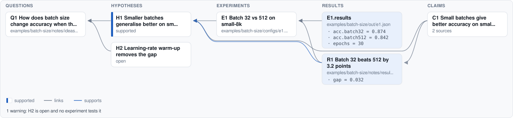

# research-diff

Maps your research from its notes, experiment configs, results and paper (questions, hypotheses, experiments,
results, claims) and shows what each iteration changed. Built for exploring ideas with AI coding agents.

<!-- research-map:begin -->


<details><summary>1 open warning</summary>

- H2 is open and no experiment tests it

</details>
<!-- research-map:end -->

The map above is this repository's own example (`examples/batch-size`), regenerated from its files on every change.

## What it reads

Markers in your own files, in one grammar: an id (`Q` question, `H` hypothesis, `E` experiment, `R` result,
`C` claim, and a number) and a title, then links and a status on the lines after it.

```markdown
## H2: Learning-rate warm-up removes the gap      <- notes (Markdown): a heading or a list item
answers: Q1
status: open                                      <- open | supported | refuted | anything you like
```

| Where | How |
|---|---|
| Notes (`.md`) | definitions as above; `tests:`, `of:`, `supports:`, `weakens:`, `relies on:`, `metrics: acc=0.91` |
| Experiment configs (YAML, JSON, TOML) | a `research:` block: `id`, `title`, `tests`, `status`, and `results: out/e1.json`, whose numbers become the result `E1.results` |
| Scripts and notebooks | a comment: `# research-diff: E2 tests H2` |
| The paper (LaTeX) | a comment: `% C1: Small batches win` and `% relies on: H1, R1`; the paragraph's `\cite{…}` become its sources; `% expects: E1.results acc.batch32 > 0.85` warns when a result stops meeting it |

The map is built from markers only, so the same files always give the same map. It warns when a claim relies on
nothing or on a refuted hypothesis, when a number no longer meets what a claim `expects:`, when an open hypothesis has no experiment, and when a link points at nothing.

## Use

```sh
pipx install research-diff
research-diff map --out docs            # research.svg and research.json
research-diff diff --base HEAD          # what your uncommitted iteration did
research-diff sync                      # MLflow / W&B runs into research/runs.json
research-diff checkpoint                # mark what you have understood
research-diff diff                      # only what came after that
```

A diff reads like: *Adds 1 hypothesis (H3); H1: open → refuted; E1.results acc.b32: 0.874 → 0.881 (+0.8%); 1 new
link; 2 new warnings (C1 relies on H1, which is refuted…).* It comes with the exact list (`plan.txt`) and a picture of
only what changed (`diff.svg`).

## With AI coding agents

```sh
pipx inject research-diff mcp
research-diff setup claude     # a Stop hook, a skill and the MCP server (--scope project, --undo)
research-diff watch            # http://127.0.0.1:8766/ : the research diff since your checkpoint, live
```

After every Claude Code turn one line says what changed in the research. The agent's tools: `research_diff`,
`research_map`, `log_result` (records a run's metrics and what it supports or weakens in `research/log.md`, so it is
on the map and in git) and `checkpoint`. The pictures, snapshots and live page are
[system-diff](https://github.com/simplifiedmachine/system-diff)'s.

## Experiment trackers

Runs logged to MLflow (its local `mlruns/` store) or W&B (its local `wandb/` folders) become results of the experiment
they are tagged with: `research-diff.experiment` (or `research_id`) as an MLflow tag or param, `research_id` in the W&B
config. Tracker folders are usually git-ignored, so `research-diff sync` copies their runs into `research/runs.json`,
which is tracked: the runs are then on the map, in git and in the next diff. The hook, the live page and the MCP tools
sync on their own.

## Markers suggested by your LLM

```sh
research-diff suggest                 # notes and paper files with no marker yet, or name the files
git apply .git/research-diff/suggest.patch
```

Your LLM (the one your Claude Code uses) proposes markers for what the text already says. Each proposal is checked
before it reaches the patch: a real line of a file it was shown, a marker in that file's own form, and no id that is
already used. Nothing is written until you apply the patch.

## License

MIT
